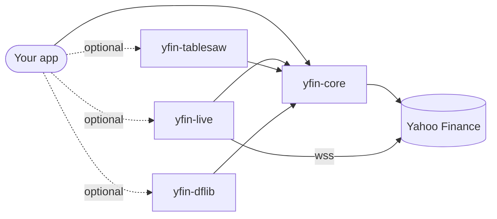

<div align="center">

# yfin

**Yahoo Finance market data for Java 25: a port of [yfinance](https://github.com/ranaroussi/yfinance).**

[](https://central.sonatype.com/artifact/io.github.andreygrigoriev/yfin-core)
[](https://javadoc.io/doc/io.github.andreygrigoriev/yfin-core)
[](https://github.com/andreygrigoriev/yfin/actions/workflows/ci.yml)
[](https://github.com/andreygrigoriev/yfin/actions/workflows/nightly-live.yml)
<br>
[](https://openjdk.org/projects/jdk/25/)
[](#graalvm-native-image)
[](#yfinance--yfin-mapping)
[](LICENSE)

[Install](#install) · [Quickstart](#quickstart) · [Examples](#examples) ·
[yfinance mapping](#yfinance--yfin-mapping) · [Contributing](CONTRIBUTING.md)

</div>

yfin covers what yfinance does. You create one client, the calls block (use virtual threads for
concurrency), and results come back as immutable records. DataFrame adapters for Tablesaw and DFLib
are optional. The reference version is yfinance 1.7.0 (see [`NOTICE`](NOTICE)).

> [!WARNING]
> yfin is not affiliated with, endorsed by, or vetted by Yahoo, Inc. It uses Yahoo's publicly
> available endpoints, which are undocumented and can change without notice. Yahoo Finance data is
> for personal use only. You are responsible for following
> [Yahoo's terms of use](https://legal.yahoo.com/us/en/yahoo/terms/otos/index.html). Use yfin for
> personal and research use only.

## Features

| | Area | What you get |
|---|---|---|
| 📈 | [Price history](#price-history) | OHLCV bars for any period or interval, dividends, splits, optional price repair |
| 🏢 | [Info](#info-and-fast-info) | company profile, quote snapshot, cheap `fastInfo()`, ISIN |
| 📊 | [Financials](#financial-statements-and-valuation) | income statement, balance sheet, cash flow (annual, quarterly, TTM), valuation |
| 👥 | [Holders and analysts](#holders-analysts-earnings-calendar) | institutional and insider holders, recommendations, price targets, estimates |
| 🔗 | [Options](#options) | expirations and full option chains |
| 📰 | [News](#news-and-shares) | news and press releases, share count history |
| 📦 | [Bulk download](#bulk-download-and-tickers) | many symbols at once, with partial results on failure |
| 🔎 | [Search and screener](#search-and-lookup) | search, lookup by type, predefined and custom screeners |
| 🗓️ | [Market calendars](#market-calendars) | earnings, IPO, economic events and splits calendars |
| 🌍 | [Sectors and markets](#sector-industry-market) | sector and industry leaders, market status and summary |
| ⚡ | [Live streaming](#live-streaming-yfin-live) | WebSocket price ticks with automatic reconnect |
| 🧮 | [DataFrames](#dataframes-yfin-tablesaw-yfin-dflib) | Tablesaw `Table` and DFLib `DataFrame` conversions |

It is also built for production use: one thread-safe client with no global state, a client-wide
concurrency limit with retries and backoff, a pluggable HTTP transport, JPMS modules, and
[GraalVM native image](#graalvm-native-image) support without extra flags.

<details>
<summary><b>Table of contents</b></summary>

- [Install](#install)
- [Quickstart](#quickstart)
- [Configuration](#configuration)
- [Data conventions](#data-conventions)
- [Examples](#examples)
- [Errors](#errors)
- [Rate limits](#rate-limits)
- [Logging](#logging)
- [yfinance → yfin mapping](#yfinance--yfin-mapping)
- [GraalVM native image](#graalvm-native-image)
- [Contributing](#contributing)
- [License](#license)

</details>

## Install

All modules are published to Maven Central under `io.github.andreygrigoriev`. They are released together
with one shared version, and they need Java 25.

| Artifact | JPMS module | Contents | Extra dependencies |
|---|---|---|---|
| `yfin-core` | `io.andreygrigoriev.yfin` | client, `Ticker`, every endpoint, models | Jackson, SLF4J API |
| `yfin-live` | `io.andreygrigoriev.yfin.live` | WebSocket price streaming | protobuf-java |
| `yfin-tablesaw` | `io.andreygrigoriev.yfin.tablesaw` | records → Tablesaw `Table` | tablesaw-core |
| `yfin-dflib` | `io.andreygrigoriev.yfin.dflib` | records → DFLib `DataFrame` | dflib |



**Maven**

```xml
<dependency>
    <groupId>io.github.andreygrigoriev</groupId>
    <artifactId>yfin-core</artifactId>
    <version>0.1.1</version>
</dependency>
<!-- optional -->
<dependency>
    <groupId>io.github.andreygrigoriev</groupId>
    <artifactId>yfin-live</artifactId>
    <version>0.1.1</version>
</dependency>
```

**Gradle (Kotlin DSL)**

```kotlin
dependencies {
    implementation("io.github.andreygrigoriev:yfin-core:0.1.1")
    // optional
    implementation("io.github.andreygrigoriev:yfin-live:0.1.1")
    implementation("io.github.andreygrigoriev:yfin-tablesaw:0.1.1")
    implementation("io.github.andreygrigoriev:yfin-dflib:0.1.1")
}
```

**Module path.** Add `requires io.andreygrigoriev.yfin;`, or the `.live`, `.tablesaw` or `.dflib`
module, each of which re-exports core. Core exports only `io.andreygrigoriev.yfin`, `…yfin.model`,
`…yfin.request`, `…yfin.spi` and `…yfin.exception`. Everything under `…yfin.internal` is private.

## Quickstart

```java
import io.andreygrigoriev.yfin.Ticker;
import io.andreygrigoriev.yfin.YFinance;
import io.andreygrigoriev.yfin.model.Bar;
import io.andreygrigoriev.yfin.model.PriceHistory;
import io.andreygrigoriev.yfin.request.Period;

try (YFinance yf = YFinance.create()) {
    Ticker aapl = yf.ticker("AAPL");

    PriceHistory history = aapl.history(Period.ONE_MONTH);   // daily bars
    for (Bar bar : history.bars()) {
        System.out.println(bar.time() + " " + bar.close() + " " + bar.volume());
    }

    System.out.println(aapl.info().longName() + " " + aapl.fastInfo().lastPrice());
}
```

> [!TIP]
> `YFinance` is thread-safe and holds the HTTP client, the Yahoo session (cookie and crumb) and the
> cache. Create one, share it, and close it when you are done. A `Ticker` is a lightweight handle
> with no state: each call sends a new request.

## Configuration

Configuration goes through the builder:

```java
YFinance yf = YFinance.builder()
        .connectTimeout(Duration.ofSeconds(10))     // default 10 s
        .requestTimeout(Duration.ofSeconds(30))     // default 30 s
        .maxConcurrentRequests(8)                   // default 8
        .maxRetries(2)                              // retries on 429/5xx, default 2
        .proxy(ProxySelector.of(new InetSocketAddress("proxy.local", 3128)))
        .userAgent("Mozilla/5.0 ...")               // default: a desktop Chrome User-Agent
        .cacheDir(Path.of("/var/cache/yfin"))       // or .cache(Cache.none())
        .repair(true)                               // price repair for history(); off by default
        .build();
```

**Custom transport.** `Transport` (`io.andreygrigoriev.yfin.spi`) is a public SPI for the HTTP
layer. Pass your own with `.transport(myTransport)` to change TLS, add logging or headers, or stub
Yahoo in tests.

> [!NOTE]
> With a custom transport, `proxy`, `connectTimeout`, `requestTimeout` and `userAgent` are ignored,
> since they configure the default JDK transport. A transport that manages cookies itself (or wraps
> one that does) should return its store from `Transport.cookieStore()`. Otherwise yfin keeps the
> Yahoo cookies and sends the `Cookie` header itself.

## Data conventions

| Kind of value | Representation |
|---|---|
| Time-series prices | `double`; a missing value is `Double.NaN`, a missing volume is `0` |
| Scalar snapshot fields (`TickerInfo`, `FastInfo`, analyst targets) | boxed and `@Nullable` |
| Bar and event times | `ZonedDateTime` in the exchange time zone |
| Statement periods and calendar dates | `LocalDate` |
| Collections | unmodifiable |
| No data from Yahoo | an empty list or `Optional.empty()`, not an exception |
| Semi-structured records | a `raw()` map with the full Yahoo payload |

## Examples

The snippets below share a client `yf` and the `msft` ticker from the first one.

### Price history

```java
Ticker msft = yf.ticker("MSFT");

PriceHistory daily = msft.history(Period.ONE_YEAR);
PriceHistory intraday = msft.history(HistoryRequest.of(Period.FIVE_DAYS, Interval.FIVE_MINUTES));
PriceHistory custom = msft.history(HistoryRequest.builder()
        .start(LocalDate.of(2024, 1, 1))
        .end(LocalDate.of(2024, 7, 1))
        .interval(Interval.ONE_WEEK)
        .autoAdjust(false)       // keep raw OHLC, adjClose separate
        .prepost(false)
        .repair(true)            // overrides the client default
        .build());

List<Dividend> dividends = msft.dividends();
List<Split> splits = msft.splits();
HistoryMetadata meta = msft.historyMetadata();
```

Crypto (`BTC-USD`, 24/7, UTC) and non-US listings (`SAP.DE`, `CBA.AX`) work the same way. Bar times
use the exchange's own time zone (`history.exchangeZone()`).

### Info and fast info

```java
TickerInfo info = msft.info();          // ~40 typed accessors + raw()
String sector = info.sector();
Long marketCap = info.marketCap();

FastInfo fast = msft.fastInfo();        // lazy: requests made on first access
Double last = fast.lastPrice();

Optional<String> isin = msft.isin();
```

### Financial statements and valuation

```java
FinancialStatement income = msft.incomeStatement(Frequency.ANNUAL);   // QUARTERLY, TRAILING
SortedMap<LocalDate, Double> revenue = income.get(LineItem.TOTAL_REVENUE);
double latest = income.value(LineItem.TOTAL_REVENUE, income.periods().getFirst());

FinancialStatement balance = msft.balanceSheet(Frequency.QUARTERLY);
FinancialStatement cash = msft.cashFlow(Frequency.TRAILING);
ValuationMeasures valuation = msft.valuationMeasures();
```

`LineItem` constants use Yahoo key names (`TotalRevenue`, `NetIncome`, …). Use `get(String)` for
any other key.

### Holders, analysts, earnings, calendar

```java
Optional<MajorHolders> major = msft.majorHolders();
List<Holder> institutions = msft.institutionalHolders();
List<InsiderTransaction> insiders = msft.insiderTransactions();

List<Recommendation> recommendations = msft.recommendations();
Optional<PriceTargets> targets = msft.analystPriceTargets();
List<EarningsEstimate> estimates = msft.earningsEstimate();
List<UpgradeDowngrade> changes = msft.upgradesDowngrades();

List<EarningsDate> earnings = msft.earningsDates(12);
Optional<Calendar> calendar = msft.calendar();
List<SecFiling> filings = msft.secFilings();
Optional<FundsData> funds = yf.ticker("SPY").fundsData();
```

### Options

```java
List<LocalDate> expirations = msft.optionExpirations();
OptionChain chain = msft.optionChain(expirations.getFirst());
for (OptionContract call : chain.calls()) {
    System.out.println(call.contractSymbol() + " " + call.strike() + " " + call.lastPrice());
}
```

### News and shares

```java
List<NewsItem> news = msft.news(10, NewsTab.PRESS_RELEASES);
List<SharesCount> shares = msft.sharesFull(LocalDate.now().minusYears(1), null);
```

### Bulk download and `Tickers`

```java
try {
    Map<String, PriceHistory> data =
            yf.download(List.of("AAPL", "MSFT", "GOOG"), HistoryRequest.of(Period.SIX_MONTHS));
} catch (YFDownloadException e) {
    Map<String, PriceHistory> ok = e.partialResults();
    Map<String, YFinanceException> failed = e.failures();
}

Tickers tickers = yf.tickers("AAPL", "MSFT");
Map<String, PriceHistory> history = tickers.history(Period.ONE_MONTH);
Map<String, List<NewsItem>> news = tickers.news();
```

> [!IMPORTANT]
> `download` is strict. If any symbol fails, it throws `YFDownloadException`, and the exception
> carries the successful results.

### Search and lookup

```java
SearchResult result = yf.search(Search.of("apple").maxResults(5).newsCount(3));
result.quotes().forEach(q -> System.out.println(q.symbol() + " " + q.longName()));

List<LookupResult> etfs = yf.lookup(Lookup.of("gold").type(LookupType.ETF).count(10));
```

### Screener

```java
ScreenerResult gainers = yf.screen("day_gainers");
ScreenerResult megaCaps = yf.screen(Screener.of(EquityQuery.and(
                EquityQuery.eq("region", "us"),
                EquityQuery.gt("intradaymarketcap", 100_000_000_000L)))
        .size(25)
        .sort(SortField.descending("intradaymarketcap")));

Set<String> predefined = Screener.predefinedNames();
Map<String, Set<String>> fields = EquityQuery.validFields();   // FundQuery, EtfQuery likewise
```

### Market calendars

```java
List<EarningsEvent> earnings = yf.earningsCalendar();      // today..+7 days, 12 rows, most-active filter on
List<EarningsEvent> bigCaps = yf.earningsCalendar(EarningsCalendarRequest
        .between(LocalDate.of(2026, 10, 19), LocalDate.of(2026, 10, 23))
        .marketCap(1e9)
        .filterMostActive(false)
        .limit(50));
List<IpoEvent> ipos = yf.ipoCalendar(CalendarRequest.from(LocalDate.now()).limit(100));
List<EconomicEvent> econ = yf.economicEventsCalendar();
List<SplitEvent> splits = yf.splitsCalendar(CalendarRequest.between(start, end));
```

Every call makes its own request(s); nothing is cached. `limit` must be in `1..100`; page with
`offset(n)`. Earnings are sorted by start time, newest first, with times in `America/New_York`.

### Sector, industry, market

```java
Sector tech = yf.sector("technology");
List<TopCompany> leaders = tech.topCompanies();
Map<String, String> etfs = tech.topEtfs();

Industry chips = yf.industry("semiconductors");
List<GrowthCompany> growth = chips.topGrowthCompanies();

Market us = yf.market(MarketRegion.US);
Optional<MarketStatus> status = us.status();
List<MarketSummaryItem> summary = us.summary();
```

### Live streaming (`yfin-live`)

```java
try (YFinance yf = YFinance.create();
        LiveStream stream = YFinanceLive.connect(yf, tick ->
                System.out.println(tick.id() + " " + tick.price() + " @ " + tick.time()))) {
    stream.subscribe("AAPL", "BTC-USD");
    Thread.sleep(Duration.ofMinutes(1));
}
```

Listener callbacks run on virtual threads. If the connection drops, the stream reconnects with
backoff and subscribes again. To get decoding or connection errors, override
`LiveListener.onError`. Use `YFinanceLive.builder(yf)` to set the heartbeat, reconnect delays,
proxy or URI.

### DataFrames (`yfin-tablesaw`, `yfin-dflib`)

```java
Table bars = TablesawAdapter.toTable(msft.history(Period.ONE_YEAR));        // Date/Open/High/…
Table statement = TablesawAdapter.toTable(msft.incomeStatement(Frequency.ANNUAL));
Table options = TablesawAdapter.optionsToTable(chain.calls());

DataFrame df = DFLibAdapter.toDataFrame(msft.history(Period.ONE_YEAR));
DataFrame holders = DFLibAdapter.holdersToDataFrame(msft.institutionalHolders());
DataFrame ipoFrame = DFLibAdapter.ipoCalendarToDataFrame(yf.ipoCalendar());
```

## Errors

Every exception is unchecked and extends `YFinanceException`:

| Exception | When |
|---|---|
| `YFRateLimitException` | HTTP 429 after all retries |
| `YFTransportException` | network failure, timeout, interrupt, or 5xx after all retries |
| `YFAuthException` | the cookie or crumb could not be obtained, or Yahoo rejected the session |
| `YFSymbolNotFoundException` | Yahoo reports the symbol as unknown or delisted |
| `YFDataException` | unexpected payload (message includes a truncated snippet) |
| `YFDownloadException` | bulk download with failures (`failures()`, `partialResults()`) |

## Rate limits

Yahoo throttles heavy clients with HTTP 429, and sometimes with a temporary block. yfin limits the
load it sends:

- **Concurrency.** At most `maxConcurrentRequests` requests are in flight at once (default 8). This
  applies to the whole client, including `download` and `Tickers`.
- **Retries.** 429 and 5xx responses are retried with exponential backoff and full jitter (base
  1 s), up to `maxRetries` times (default 2). A `Retry-After` header is honored, capped at the
  maximum delay. When retries run out, you get `YFRateLimitException` or `YFTransportException`.
- **Caching.** The cookie and crumb are cached (`~/.cache/yfin`, or `$XDG_CACHE_HOME/yfin`). Only
  one thread fetches them at a time, and they are refreshed once on 401 or "Invalid Crumb".
  Exchange time zones and ISINs are cached too, which saves requests.

Recommendations:

- Use one shared `YFinance` instance. Several instances each have their own limit and session.
- For hundreds of symbols, lower `maxConcurrentRequests` (2 to 4), spread the work over time, and
  catch `YFRateLimitException` to back off at the application level.
- `fastInfo()` is cheaper than `info()`, which makes three requests.

> [!CAUTION]
> If Yahoo blocks your IP, wait. Retrying immediately makes the block last longer.

## Logging

yfin logs through the SLF4J 2.x API and ships no binding. Add one (Logback, `slf4j-simple`,
`log4j-slf4j2-impl`, …) to see the logs. Without a binding, SLF4J prints one warning and drops all
messages. This replaces yfinance's `enable_debug_mode()`. For example, with Logback:

```xml
<logger name="io.andreygrigoriev.yfin" level="DEBUG"/>
```

<details>
<summary><b>Logger names</b> (class names under <code>io.andreygrigoriev.yfin</code>)</summary>

| Logger | What it logs |
|---|---|
| `io.andreygrigoriev.yfin.internal.http.RetryPolicy` | retries, backoff delays (debug/warn) |
| `io.andreygrigoriev.yfin.internal.http.YahooSession` | cookie/crumb bootstrap, consent flow, refresh |
| `io.andreygrigoriev.yfin.internal.endpoint` | per-endpoint requests and payload issues |
| `io.andreygrigoriev.yfin.internal.repair` | price repair decisions |
| `io.andreygrigoriev.yfin.internal.cache.FileCache` | cache file read/write problems (warn; the cache then ignores the file) |
| `io.andreygrigoriev.yfin.live.LiveStream` | connect, reconnect, decode errors |

</details>

## yfinance → yfin mapping

Coming from Python? Most names translate directly: snake_case properties become camelCase methods,
and keyword arguments become request builders.

```python
# yfinance
t = yf.Ticker("AAPL")
t.history(period="1mo", interval="1d")
t.quarterly_income_stmt
```

```java
// yfin
Ticker t = yf.ticker("AAPL");
t.history(HistoryRequest.of(Period.ONE_MONTH, Interval.ONE_DAY));
t.incomeStatement(Frequency.QUARTERLY);
```

<details>
<summary><b>Full API mapping</b></summary>

| yfinance | yfin |
|---|---|
| `yf.Ticker("AAPL")` | `yf.ticker("AAPL")` |
| `Ticker.history(period=, interval=, start=, end=, prepost=, auto_adjust=, back_adjust=, actions=, repair=, keepna=)` | `history(HistoryRequest)` / `history(Period)` / `history()` |
| `dividends`, `splits`, `capital_gains`, `actions`, `history_metadata` | `dividends()`, `splits()`, `capitalGains()`, `actions()`, `historyMetadata()` |
| `info`, `fast_info` | `info()` (`TickerInfo`, incl. `trailingPegRatio`), `fastInfo()` |
| `major_holders`, `institutional_holders`, `mutualfund_holders` | `majorHolders()`, `institutionalHolders()`, `mutualFundHolders()` |
| `insider_transactions`, `insider_purchases`, `insider_roster_holders` | `insiderTransactions()`, `insiderPurchases()`, `insiderRosterHolders()` |
| `recommendations`, `recommendations_summary`, `upgrades_downgrades` | `recommendations()`, `recommendationsSummary()`, `upgradesDowngrades()` |
| `analyst_price_targets`, `earnings_estimate`, `revenue_estimate`, `earnings_history`, `eps_trend`, `eps_revisions`, `growth_estimates` | `analystPriceTargets()`, `earningsEstimate()`, `revenueEstimate()`, `earningsHistory()`, `epsTrend()`, `epsRevisions()`, `growthEstimates()` |
| `calendar`, `sustainability` | `calendar()`, `sustainability()` |
| `income_stmt` / `quarterly_income_stmt` / `ttm_income_stmt` | `incomeStatement(Frequency.ANNUAL / QUARTERLY / TRAILING)` |
| `balance_sheet`, `cash_flow` (+ quarterly/ttm) | `balanceSheet(Frequency)`, `cashFlow(Frequency)` |
| `valuation` / `get_valuation_measures(freq)` | `valuationMeasures()` / `valuationMeasures(Frequency)` |
| `earnings_dates` / `get_earnings_dates(limit)` | `earningsDates()` / `earningsDates(int)` |
| `options`, `option_chain(date)` | `optionExpirations()`, `optionChain()` / `optionChain(LocalDate)` |
| `news` / `get_news(count, tab)` | `news()` / `news(int, NewsTab)` |
| `get_shares_full(start, end)` | `sharesFull()` / `sharesFull(LocalDate, LocalDate)` |
| `isin`, `sec_filings`, `funds_data` | `isin()`, `secFilings()`, `fundsData()` |
| `yf.Tickers("A B")` | `yf.tickers("A", "B")` → `history(...)`, `news()`, `ticker(symbol)` |
| `yf.download(...)` | `yf.download(symbols, HistoryRequest)` (strict, `YFDownloadException`) |
| `yf.Search(query, ...)` | `yf.search(Search.of(query)...)` → `SearchResult` |
| `yf.Lookup(query).get_etf(...)` | `yf.lookup(Lookup.of(query).type(LookupType.ETF).count(n))` |
| `yf.screen(query or name, offset, size, sortField, sortAsc)` | `yf.screen(Screener.of(query) / Screener.predefined(name)...)` |
| `EquityQuery`, `FundQuery` | `EquityQuery`, `FundQuery`, `EtfQuery` (same operators, `validFields()`, `validValues()`) |
| `yf.Sector(key)`, `yf.Industry(key)` | `yf.sector(key)`, `yf.industry(key)` |
| `yf.Market(region)` → `status`, `summary` | `yf.market(MarketRegion)` → `status()`, `summary()` |
| `yf.Calendars(start, end).get_earnings_calendar(market_cap=, filter_most_active=, limit=, offset=)` | `yf.earningsCalendar(EarningsCalendarRequest.between(start, end).marketCap(...).filterMostActive(...).limit(n).offset(n))` |
| `Calendars.get_ipo_info_calendar`, `get_economic_events_calendar`, `get_splits_calendar` | `yf.ipoCalendar(CalendarRequest)`, `yf.economicEventsCalendar(CalendarRequest)`, `yf.splitsCalendar(CalendarRequest)` |
| `yf.WebSocket` | `YFinanceLive.connect(yf, listener)` (`yfin-live`) |
| `yf.set_config(proxy=, retries=)`, `set_tz_cache_location` | `YFinance.builder().proxy(...).maxRetries(...).cacheDir(...)` |
| `yf.enable_debug_mode()` | SLF4J logger levels |

</details>

### Not ported, or different on purpose

<details>
<summary><b>Intentional differences from yfinance</b></summary>

| yfinance | Status in yfin |
|---|---|
| `Calendars` caching and `force=` | stateless: every call makes its own request(s), and the most-active symbol list is not cached. |
| `Calendars(start=None or end=None)` | the window is always complete: `between(start, end)` (rejects `end < start`), `from(start)` (7 days) or `nextWeek()`. |
| `Calendars` `limit > 100` | rejected with `IllegalArgumentException`; yfinance silently caps it at 100. |
| `filter_most_active` with no surviving symbol | an empty list, without querying the calendar. yfinance sends an empty `OR`. |
| `filter_most_active` screener failure | the screener exception propagates. yfinance logs it and continues unfiltered. |
| economic events `Date` column | `EconomicEvent.time` is an `Instant`, because the events aren't tied to an exchange. |
| earnings calendar `Event Start Date` | `EarningsEvent.startTime` is a `ZonedDateTime` in `America/New_York` (the query is `region = us`). |
| `Auth.set_login_cookies` (Yahoo account cookies) | not ported, because it needs account credentials. A custom `Transport` can add cookies. |
| `earnings`, `quarterly_earnings`, `get_earnings` | deprecated upstream and always `None` there. Use `incomeStatement(...).get(LineItem.NET_INCOME)`. |
| `get_shares` | raises `YFNotImplementedError` upstream. Use `sharesFull()`. |
| `AsyncWebSocket`, `Ticker.live`, `Tickers.live` | use `yfin-live`: a blocking API plus virtual threads instead of asyncio. |
| `as_dict`, `pretty`, statement aliases (`incomestmt`, `financials`, `balancesheet`, `cashflow`) | typed records and one name per statement. Use the adapters for DataFrames. |
| `get_valuation_measures(freq="monthly")`, `periods` cap | no monthly frequency, and all periods are kept. |
| `Tickers("A B")` string splitting | pass separate symbols, or a collection. |
| `Market.summary` dict keyed by exchange | `List<MarketSummaryItem>`, because a map would drop duplicate exchanges (for example two `PAR` entries in `EUROPE`). |
| `majorDirectHolders` | not exposed. yfinance doesn't parse it, and Yahoo sends an empty list. |
| price repair `_dividends_convert_fx` | not ported. Dividends in a currency different from the prices are not converted. |
| earnings dates source | Yahoo's `sp_earnings` visualization JSON, not the HTML scrape of the calendar page. |
| unknown symbol on statements | empty `FinancialStatement`, not an exception. Yahoo answers the same way as for ETFs. |
| `fundsData()` on a non-fund | `Optional.empty()` instead of an exception |

</details>

## GraalVM native image

Applications using yfin can be compiled into native executables. You don't need extra
`native-image` flags, `--enable-url-protocols`, or your own reachability metadata. Each module
ships its metadata at `META-INF/native-image/io.github.andreygrigoriev/<artifactId>/reachability-metadata.json`.

| Module | Native status | Notes |
|---|---|---|
| `yfin-core` | ✅ supported | JSON goes through the Jackson tree model, so no reflection metadata is needed. The JDK `HttpClient` over HTTPS works with no flags. |
| `yfin-live` | ✅ supported | Protobuf `PricingData` decoding and the JDK `WebSocket` (`wss://`) work. The metadata registers protobuf-java's reflective `ExtensionRegistry` lookup. |
| `yfin-tablesaw` | ⚠️ best effort | Tablesaw's `Table` runs a ClassGraph classpath scan in its static initializer; the shipped metadata lets that scan run. In a native image the scan finds no Tablesaw readers or writers, which the adapter does not use. Tablesaw's own CSV and other I/O is not covered. |
| `yfin-dflib` | ⚠️ best effort | The adapter's tests pass in a native image with no metadata. |

Every module's unit tests also run as a native image (`./mvnw -Pnative test` on GraalVM 25). That
profile turns off the GraalVM reachability metadata repository, so the tests rely only on the
metadata yfin ships. `yfin-it` builds a small consumer app (history, info, income statement, a 10 s
live stream) as a native executable from the plugin defaults alone. `./mvnw verify -Plive,native`
builds it and runs it against Yahoo.

## Contributing

Build requirements, formatting rules, fixture recording and the release process are in
[CONTRIBUTING.md](CONTRIBUTING.md). The short version: `./mvnw verify` must pass before a commit.

## License

yfin is licensed under the [Apache License 2.0](LICENSE). It is a port of
[yfinance](https://github.com/ranaroussi/yfinance), also Apache 2.0; see [`NOTICE`](NOTICE) for
attribution.
